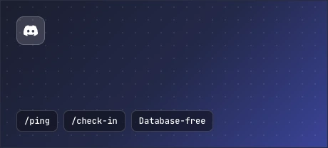

# Roll Call for Discord

Roll Call is a tiny starter for building Discord bots on Workers. `/check-in` acknowledges a daily check-in. `/ping` confirms the bot is online. Both replies are visible only to the person running the command. The website includes an interactive demo served by the same Worker.



Roll Call receives signed HTTP interactions from Discord. It uses Web Crypto and has no Gateway process, privileged intents, or database dependency. Check-ins are acknowledged immediately and no check-in history is stored.

## Try the site locally

Requires Node.js 22.12 or newer.

```sh
npm ci
npm run dev
npm test
npm run build
```

The site and command demo work without a Discord app. `npm run build` checks the production bundle with a Wrangler dry run.

## Deploy your bot

1. Create a Discord app in the [Developer Portal](https://discord.com/developers/applications). In **Installation**, enable **Guild Install** with the `applications.commands` scope. Use its install link to add the app to a server you administer.
2. Set `DISCORD_PUBLIC_KEY` to the public key shown in the app’s **General Information**. In Freecode, add it to the Published environment in **Secrets**, then use **Publish** or **Update site**. With Wrangler, run `npm run deploy` and then `npx wrangler secret put DISCORD_PUBLIC_KEY`.
3. Set **Interactions Endpoint URL** to `https://<your-site>/interactions`. Discord will send a signed PING to verify the URL.
4. Copy `.env.register.example` to `.env.register`, fill in your app ID and bot token locally, then run `npm run register`. Set `DISCORD_TEST_GUILD_ID` to register the commands immediately in a test server. The Worker itself does not need the bot token.
5. Run `/ping` and `/check-in` in the Discord server.

## Make it yours

The command responses live in `src/commands.js`. A useful next step is to add persistent check-ins and a daily count per server. Keep that history isolated by server and make repeated check-ins on the same day idempotent.

MIT licensed. Artwork created with ImageGen. `docs/art/catalog-cover.webp` is the catalog artwork and `docs/art/website.webp` is a browser capture.
