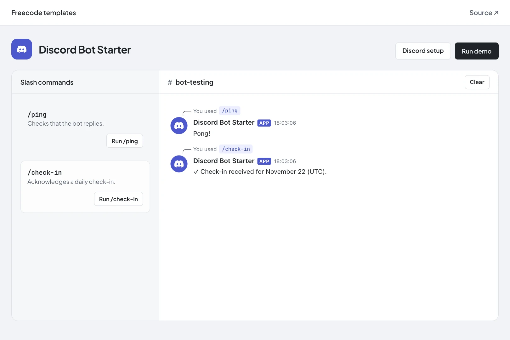

# Roll Call for Discord

Roll Call is a tiny starter for building Discord bots on Workers. `/check-in` acknowledges a daily check-in. `/ping` confirms the bot is online. Both replies are visible only to the person running the command. The same Worker serves a dashboard for testing commands and setting up Discord.



Roll Call receives signed HTTP interactions from Discord. It uses Web Crypto and has no Gateway process, privileged intents, or database dependency. Check-ins are acknowledged immediately and no check-in history is stored.

## Try the site locally

Requires Node.js 22.12 or newer.

```sh
npm ci
npm run dev
npm test
npm run build
```

The site and command demo work without a Discord app. `npm run build` checks the production bundle with a Wrangler dry run.

## Deploy your bot

1. Create a Discord app in the [Developer Portal](https://discord.com/developers/applications). In **Installation**, enable **Guild Install** with the `applications.commands` scope. Use its install link to add the app to a server you administer.
2. Copy the **Application ID** and **Public Key** from **General Information** and the **token** from **Bot**. Save all three in Freecode’s setup card, then choose **Publish** or **Update site**. For a first deploy with Wrangler, copy `.dev.vars.example` to `.dev.vars`, fill in the three values, and run `npm run deploy -- --secrets-file .dev.vars`.
3. In Discord’s **General Information**, set **Interactions Endpoint URL** to `https://<your-site>/interactions` and save. Discord sends a signed PING. Roll Call verifies it with the public key, then uses the Application ID and bot token to register `/ping` and `/check-in` in the background.
4. Try both commands in your server. If they’re missing, check the Worker logs and confirm that the Application ID, bot token, and public key came from the same app. Save the endpoint again to retry.

For manual registration or testing in one guild, copy `discord-register.env.example` to `.env.register`, fill in the Application ID and bot token, and run `npm run register`. Set `DISCORD_TEST_GUILD_ID` for a guild-only registration.

## Make it yours

The command responses live in `src/commands.js`. A useful next step is to add persistent check-ins and a daily count per server. Keep that history isolated by server and make repeated check-ins on the same day idempotent.

MIT licensed.
